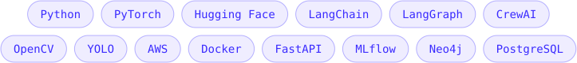

<a href="https://ahmedjafer.github.io">
  <picture>
    <source media="(prefers-color-scheme: dark)" srcset="assets/banner-dark.svg">
    
  </picture>
</a>

  
  
  
  

I'm an AI engineer working across LLMs and agents, computer vision and machine learning, from research to production. Currently a **Data Scientist at the Natural History Museum, London**, building vision-language OCR that turns historic specimen labels into structured, searchable data.

### Now

- `Oct 2026` — *Your Judge Inherits Your Prompt* accepted at **BlackboxNLP @ EMNLP 2026**
- `Aug 2026` — Joined the **Natural History Museum** as a Data Scientist on the SCRIBE project
- `Mar 2026` — Smart-glasses navigation paper accepted at the **DPH 2026** workshop

### Selected work

<table>
  <tr>
    <td width="50%" valign="top">
      <a href="https://github.com/abuba8/When-Few-Shot-Hurts"><b>VidInstructQA</b></a> 
      Training-free video QA with a frozen LLaVA-NeXT-Video generator and a LLaMA-3.1 judge; one-shot exemplar choice swings NExT-QA accuracy by 18 points. BlackboxNLP @ EMNLP '26. 
      <code>VLMs</code> <code>LLM-as-judge</code>
    </td>
    <td width="50%" valign="top">
      <a href="https://github.com/AhmedJafer/MeetingMindr"><b>MeetingMindr</b></a> 
      Meeting transcription and summarisation (Whisper, PyAnnote, GPT-4o) that turns calls into timestamped action items. 
      <code>Whisper</code> <code>LLMs</code>
    </td>
  </tr>
  <tr>
    <td width="50%" valign="top">
      <a href="https://github.com/AhmedJafer/ViT-Medical-Imaging"><b>Medical imaging with ViTs</b></a> 
      Vision Transformers vs CNNs for tumour classification, with Grad-CAM explanations and a caught dataset leak. 
      <code>ViT</code> <code>Grad-CAM</code>
    </td>
    <td width="50%" valign="top">
      <a href="https://drive.google.com/drive/folders/1PJfzOsUZ29N4mEkRWl22phbRA63ISCvP?usp=sharing"><b>VisionAid</b></a> 
      Navigation glasses for the visually impaired: YOLOv5 on a Jetson Nano with audio feedback, over 85% accuracy. 
      <code>Jetson</code> <code>YOLOv5</code>
    </td>
  </tr>
</table>

### Publications

- **Your Judge Inherits Your Prompt: In-Context Label Bias in an LLM-as-Judge Is Directional, Not Symmetric** BlackboxNLP @ EMNLP 2026 · [code](https://github.com/abuba8/When-Few-Shot-Hurts)
- **Safety-Prioritised Multimodal Navigation for Edge Smart Glasses with Constrained On-Device Language Models** DPH Workshop 2026 · [pdf](https://drive.google.com/file/d/1vtcYp9aB89_ob-vRD_OElkXLrAKe_OJr/view?usp=sharing)
- **Real-Time Agricultural Monitoring with Agrobot: A Raspberry Pi and YOLO Based Solution** IEEE ICCA 2023 · [paper](https://ieeexplore.ieee.org/document/10401368)

### Tools

<picture>
  <source media="(prefers-color-scheme: dark)" srcset="assets/tools-dark.svg">
  
</picture>

More on <a href="https://ahmedjafer.github.io">ahmedjafer.github.io</a> · MSc AI (Distinction), University of Essex · AWS Certified Machine Learning – Specialty

